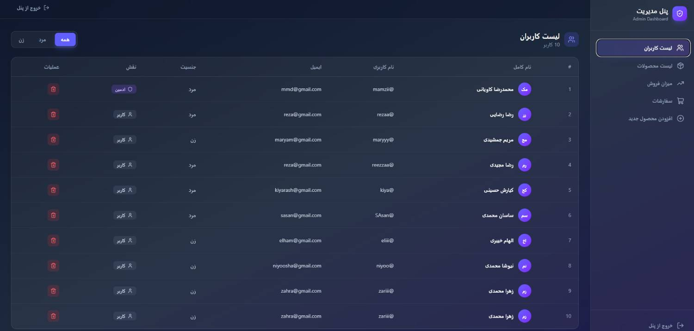
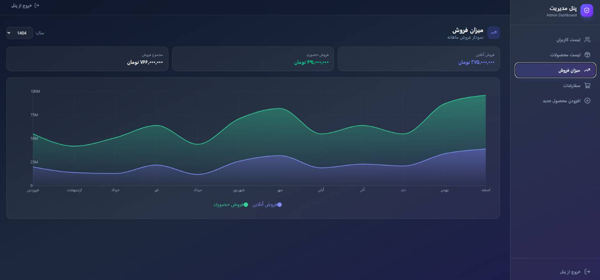
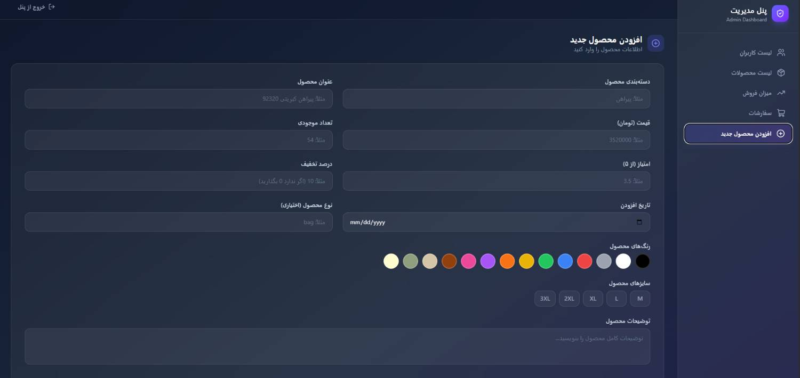
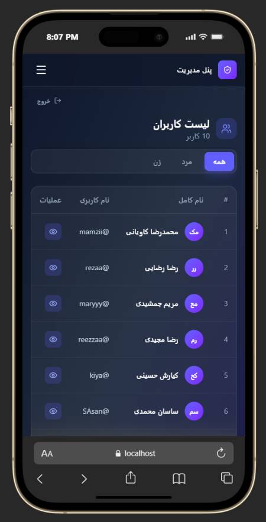

# Admin Panel

پنل مدیریت ریسپانسیو برای مدیریت کاربران، محصولات، سفارشات و مشاهده میزان فروش سالانه.

## Live Demo

**[مشاهده نسخه آنلاین](https://admin-pannel-rose.vercel.app/)**

---

## Features

- طراحی کاملاً ریسپانسیو (موبایل، تبلت و دسکتاپ)
- لیست کاربران با قابلیت فیلتر بر اساس جنسیت
- مشاهده جزئیات و حذف کاربران
- لیست محصولات با فیلتر دسته‌بندی
- افزودن محصول جدید (همراه با آپلود تصویر، انتخاب رنگ و سایز)
- مشاهده سفارشات و جزئیات هر سفارش
- نمودار فروش سالانه (آنلاین و حضوری)
- رابط کاربری مدرن با تم تیره

---

## Screenshots

### Users List


### Annual Sales


### Add New Product


### Mobile View


---

## Tech Stack

- **React** + **TypeScript**
- **Vite**
- **Tailwind CSS**
- **React Router**
- **TanStack React Query**
- **React Hook Form**
- **Recharts**
- **Axios**
- **Lucide React**
- **React Hot Toast**
- Backend: **JSON Server** (+ Multer for image upload)

---

## Getting Started

### Prerequisites

- Node.js
- Backend (JSON Server) running on port `4000`

### Installation

```bash
# clone the repository
git clone https://github.com/Mamziii/admin-pannel.git

# go to project folder
cd admin-pannel

# install dependencies
npm install

# run development server
npm run dev